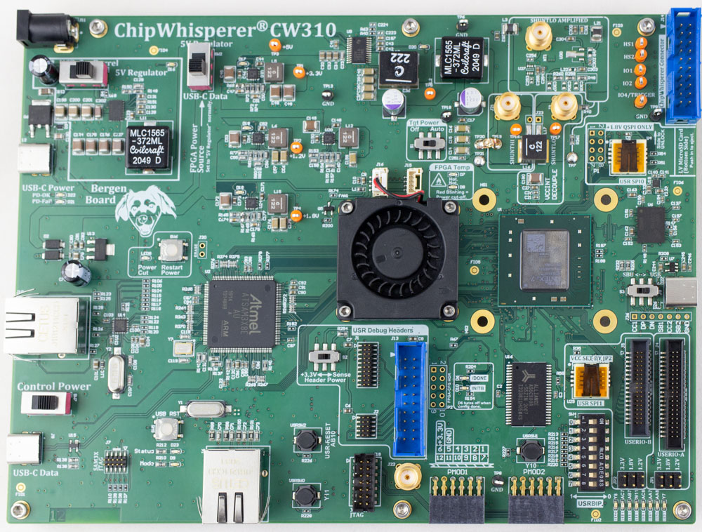

# CW310 - Kintex FPGA ('Bergen Board') Target

Full documentation for this board is rendered at [https://rtfm.newae.com/Targets/CW310 Bergen Board](https://rtfm.newae.com/Targets/CW310%20Bergen%20Board/), please see that site for documentation.

## Quick Start
See our [main readthedocs site](https://chipwhisperer.readthedocs.io/en/latest/Targets/CW310%20Bergen%20Board.html).

## Python Interface
See the target API on our [main readthedocs site](https://chipwhisperer.readthedocs.io/en/latest/target-api.html#cw310).

## Documentation
Documentation has moved to the "Target" section of our [main readthedocs site](https://chipwhisperer.readthedocs.io/en/latest/Targets/CW310%20Bergen%20Board.html).

### Firmware Documentation
See `microfw/README.md` for a firmware overview.

### Schematic
* [View schematics online](https://github.com/newaetech/cw310-bergen-board/blob/main/docs/BergenBoard_Rev06C.PDF)
* [Download PDF of Schematics](https://github.com/newaetech/cw310-bergen-board/raw/main/docs/BergenBoard_Rev06C.PDF)

### Xilinx XDC Constraints file
* [Vivado XDC Constraint File](https://github.com/newaetech/cw310-bergen-board/tree/main/pins)

